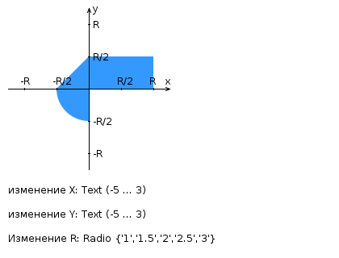

Вариант: 32405



# Задание

Доработать ЛР №1 и разработать FastCGI сервер на языке Java, определяющий попадание точки на координатной плоскости в заданную область, и создать HTML-страницу, которая формирует данные для отправки их на обработку этому серверу.

Параметр R и координаты точки должны передаваться серверу посредством HTTP-запроса. Сервер должен выполнять валидацию данных и возвращать HTML-страницу с таблицей, содержащей полученные параметры и результат вычислений — факт попадания или непопадания точки в область (допускается в ответе сервера возвращать json строку, вместо html-страницы). Предыдущие результаты должны сохраняться между запросами и отображаться в таблице.

Кроме того, ответ должен содержать данные о текущем времени и времени работы скрипта.

Комментарии по выполнению ЛР:

- Требуется поднять Apache httpd веб-сервер от лица своего пользователя на гелиосе (шаблон файла конфигурации доступен для скачивания наверху страницы)
- Веб-сервер должен заниматься обслуживанием статического контента (html, css, js) и перенаправлять запросы за динамическим контентом к FastCGI серверу
- FastCGI сервер требуется реализовать на языке Java (полезная библиотека в помощь в виде jar архива доступна для скачивания наверху страницы) и поднять также на гелиосе
- Путем обращений из JavaScript к FastCGI серверу требуется показать понимание принципа AJAX


Разработанная HTML-страница должна удовлетворять следующим требованиям (дополнительными, по отношению к ЛР №1, различаются по варианту):

- Данные формы должны передаваться на обработку посредством POST-запроса.


Методические указания к лабораторной работе №2
Вопросы к защите лабораторной работы:

1. Синхронная и асинхронная обработка HTTP-запросов. AJAX.
2. Библиотека jQuery. Назначение, основные API. Использование для реализации AJAX и работы с DOM.
3. Реализация AJAX с помощью SuperAgent.
4. Серверные сценарии. CGI - определение, назначение, ключевые особенности.
5. FastCGI - особенности технологии, преимущества и недостатки относительно CGI.
6. FastCGI сервер на языке Java.

[Файл](questions.md) подготовки по теории


# Настройка для гелиуса и запуск

## Структура папок

Файлы положить в директорию httpd-root (создать ее)

```
/home/studs/sXXXXX/httpd-root/
├── index.html       # главная страница, если название другое, в конфиге поменять
├── style.css
├── index.js
├── fcgi-bin/
│   └── PROJECT_NAME.jar     # ваш FastCGI-jar, например 2lab.jar
└──mutex-dir/httpd.conf
```

## Конфигурация 

Вот [файл](docs/httpd.conf) в котором нужно поменять только свой ID и название у вашего .jar файла если структура папок такая как выше


## Сам запуск

```
scp -rP 2222 httpd-root sXXXXXX@se.ifmo.ru:~                          # закидываем папку с файлами на свой helios

ssh -p 2222 -l sXXXXXX -L8080:localhost:24000 helios.cs.ifmo.ru       # прокидываем порт к слушающему 24000

chmod -R 700 httpd-root                                               # права на выполнение

httpd -f /home/studs/sXXXXXX/httpd-root/mutex-dir/httpd.conf -k start # запустить кофигурацию

java -jar -DFCGI_PORT=24001 httpd-root/fcgi-bin/PROJECT-NAME.jar      # запустить приложение

# на клавиатуре ctrl+c, чтобы выйти 

sockstat -4 -l -P tcp -p 24000                                        # посмотреть PID порта
kill <PID>                                                            # закрыть ресурсы
```
Приложение в браузере смотрим по http://localhost:8080/